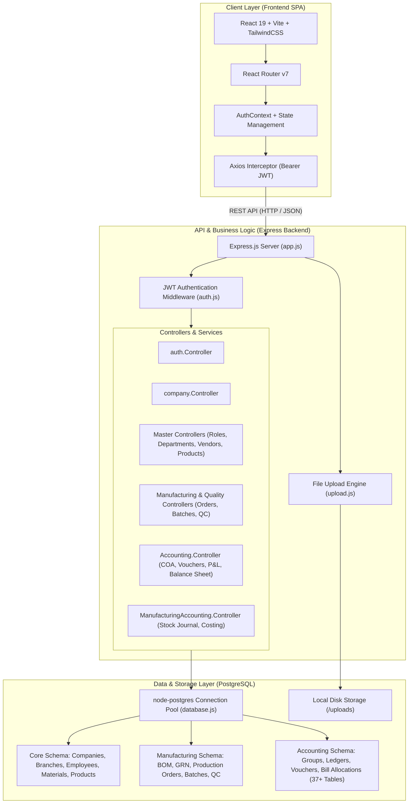

# SME / SMA - Enterprise Manufacturing & Accounting ERP System

> **SMA (Small Manufacturing & Accounting)** is an integrated, multi-tenant Enterprise Resource Planning (ERP) platform architected specifically for Small and Medium Enterprises (SMEs). It bridges the gap between shop-floor manufacturing operations, inventory control, and enterprise-grade double-entry commercial accounting modeled after industry standards like **Tally Prime**.

---

## 📑 Table of Contents

- [1. Introduction & Overview](#1-introduction--overview)
- [2. How the Application Works](#2-how-the-application-works)
  - [2.1 Organizational Hierarchy](#21-organizational-hierarchy)
  - [2.2 Operational & Manufacturing Workflow](#22-operational--manufacturing-workflow)
  - [2.3 Commercial & Sales Lifecycle](#23-commercial--sales-lifecycle)
- [3. Tally Accounting Modules & Double-Entry Engine](#3-tally-accounting-modules--double-entry-engine)
  - [3.1 Hierarchical Chart of Accounts (COA)](#31-hierarchical-chart-of-accounts-coa)
  - [3.2 Double-Entry Ledger System](#32-double-entry-ledger-system)
  - [3.3 Standard Voucher System](#33-standard-voucher-system)
  - [3.4 Bill-by-Bill Accounting & Ageing](#34-bill-by-bill-accounting--ageing)
  - [3.5 Manufacturing Journal (Stock Journal)](#35-manufacturing-journal-stock-journal)
  - [3.6 Real-Time Financial Statements & Reports](#36-real-time-financial-statements--reports)
- [4. System Architecture](#4-system-architecture)
  - [4.1 Architectural Diagram](#41-architectural-diagram)
  - [4.2 Layered Architecture](#42-layered-architecture)
  - [4.3 Role-Based Access Control (RBAC)](#43-role-based-access-control-rbac)
- [5. Complete Folder Structure](#5-complete-folder-structure)
  - [5.1 Backend Folder Structure](#51-backend-folder-structure)
  - [5.2 Frontend Folder Structure](#52-frontend-folder-structure)
- [6. Environment Variables Configuration (Demo .env)](#6-environment-variables-configuration-demo-env)
  - [6.1 Backend `.env` File](#61-backend-env-file)
  - [6.2 Frontend `.env` File](#62-frontend-env-file)
- [7. Getting Started & Installation](#7-getting-started--installation)
  - [7.1 Prerequisites](#71-prerequisites)
  - [7.2 Backend Setup](#72-backend-setup)
  - [7.3 Frontend Setup](#73-frontend-setup)
  - [7.4 Default Access Credentials](#74-default-access-credentials)

---

## 1. Introduction & Overview

Modern manufacturing enterprises struggle when shop-floor inventory operations and financial accounting reside in disconnected silos. **SME / SMA** solves this by uniting:

1. **Enterprise Organization Administration**: Multi-tenant structure supporting parent corporations, multiple branches, custom roles, and departmental divisions.
2. **Shop Floor & Production Lifecycle**: Bill of Materials (BOM), Goods Receipt Notes (GRN), Production Masters, Production Orders, Batch Tracking, Quality Inspections (QC), and Rework management.
3. **Multi-Category Inventory**: Segregated management of Raw Materials, Work-in-Progress (WIP), Finished Goods, and Capital Assets.
4. **Commercial & Tally-Compliant Accounting**: Full-featured double-entry accounting with hierarchical Account Groups, Ledgers, Voucher posting, Bill-by-Bill allocation, and instant generation of Day Book, Trial Balance, Profit & Loss, and Balance Sheet.

---

## 2. How the Application Works

### 2.1 Organizational Hierarchy

```
[Super Admin]
      │
      ▼ (Provisions)
 [Company Admin] (Parent Enterprise / Tenant)
      │
      ├───────────────────────┬───────────────────────┐
      ▼                       ▼                       ▼
 [Branch A Admin]        [Branch B Admin]        [Branch C Admin]
      │                       │                       │
      ▼                       ▼                       ▼
 [Staff / Employees]    [Staff / Employees]    [Staff / Employees]
```

- **Super Admin**: Platform owner managing enterprise client registrations, global company records, and tenant health.
- **Company Admin**: Executive organization level configured to manage branches, corporate departments, designation roles, and company-wide accounting policies.
- **Branch Admin**: Operational leader managing branch-specific warehouses, production lines, employee rosters, and regional procurement.
- **Employee**: Department-specific actors (Storekeeper, Production Supervisor, Quality Inspector, Accountant, Sales Executive) with granular, permission-based dashboards.

---

### 2.2 Operational & Manufacturing Workflow

```
[Vendor Purchase Order] ──► [GRN & Inspection] ──► [Raw Material Inventory]
                                                            │
                                                            ▼
[Product Master & BOM] ──► [Production Order] ──► [Stock Journal Consumption]
                                                            │
                                                            ▼
[Finished Goods Inventory] ◄── [QC / Rework Check] ◄── [Batch Production]
```

1. **Procurement & Goods Receipt (GRN)**:
   - Raw materials are ordered from vendors through Purchase Orders.
   - When received, a Goods Receipt Note (**GRN**) records item quantities, batch details, and inspection remarks.
   - Verified stock enters **Raw Material Inventory** with weighted/standard cost tracking.
2. **Bill of Materials (BOM) & Production Master**:
   - Products are linked with precise recipe formulas specifying required raw material quantities and estimated production costs.
3. **Production Orders & Batches**:
   - Production orders trigger batch runs on the shop floor.
   - Operators log real-time consumption of raw materials against output targets.
4. **Quality Assurance & Rework**:
   - Completed units undergo Quality Checks (**QC**).
   - Passing units are tagged `AVAILABLE` for dispatch.
   - Rejected units flow into the **Rework Management** loop for re-machining or scrap accounting.
5. **Finished Goods Inventory**:
   - Ready items are warehoused with batch tracking, manufacturing dates, and unit costing.

---

### 2.3 Commercial & Sales Lifecycle

```
[Customer Quotation] ──► [Sales Order] ──► [Delivery Note] ──► [Sales Invoice] ──► [Payment Receipt]
                                                                      │                     │
                                                                      ▼                     ▼
                                                              [Tally Sales Voucher]   [Tally Receipt Voucher]
```

1. **Quotation**: Quotation with revisions, HSN/SAC codes, tax slabs (CGST, SGST, IGST), and discounts.
2. **Sales Order**: Confirmed order tracking unbilled and undelivered quantities.
3. **Delivery Note**: Warehouse dispatch challan updating physical inventory.
4. **Tax Invoice**: GST-compliant commercial invoice creating automatic accounts receivable entries.
5. **Settlement Receipt**: Bill-by-bill payment settlement against outstanding invoices.

---

## 3. Tally Accounting Modules & Double-Entry Engine

The SMA system implements a strict, transaction-safe double-entry accounting engine inspired by **Tally Prime**:

### 3.1 Hierarchical Chart of Accounts (COA)

Every company is pre-populated with a standardized 5-nature accounting tree:
- **ASSET**: Current Assets, Bank Accounts, Cash-in-Hand, Sundry Debtors, Stock-in-Hand, Fixed Assets.
- **LIABILITY**: Current Liabilities, Sundry Creditors, Duties & Taxes (CGST, SGST, IGST), Capital Account, Loans.
- **EQUITY**: Owner's Capital, Reserves & Surplus, Retained Earnings.
- **INCOME**: Direct Incomes (Sales Accounts), Indirect Incomes (Discounts Received, Interest).
- **EXPENSE**: Direct Expenses (Raw Material Consumption, Freight Inward, Direct Labor), Indirect Expenses (Rent, Salaries, Electricity, Depreciation).

### 3.2 Double-Entry Ledger System

- Each customer, vendor, bank, cash box, revenue head, and expense line is maintained as a discrete **Ledger**.
- Ledgers track `opening_balance`, `current_balance`, and running balances with `DR` (Debit) and `CR` (Credit) polarity.
- Every ledger mutation is backed by a balanced voucher line entry satisfying:
  $$\sum \text{Debit Amounts} = \sum \text{Credit Amounts}$$

### 3.3 Standard Voucher System

The system provides standard voucher workflows:
| Voucher Category | Base Type | Typical Use Case |
|---|---|---|
| **Sales Voucher** | `SALES` | Invoicing customers; debits Debtor, credits Sales & Tax ledgers |
| **Purchase Voucher** | `PURCHASE` | Inward billing; debits Purchases & Tax, credits Creditor ledger |
| **Receipt Voucher** | `RECEIPT` | Customer remittances; debits Bank/Cash, credits Debtor ledger |
| **Payment Voucher** | `PAYMENT` | Vendor payments & expense disbursements; debits Creditor/Expense, credits Bank/Cash |
| **Contra Voucher** | `CONTRA` | Cash-to-bank deposits, bank withdrawals, or inter-bank transfers |
| **Journal Voucher** | `JOURNAL` | Non-cash adjusting entries, depreciation, and period-end accruals |
| **Credit Note** | `CREDIT_NOTE` | Sales returns or post-sale price adjustments |
| **Debit Note** | `DEBIT_NOTE` | Purchase returns or vendor debit adjustments |
| **Stock Journal** | `JOURNAL` | Manufacturing consumption vs production transformation |

### 3.4 Bill-by-Bill Accounting & Ageing

To support commercial trading and working capital analysis, ledgers marked with `maintain_bill_by_bill = true` support 4 allocation methods:
- `NEW_REF`: Assigned when generating a new sales or purchase invoice.
- `AGST_REF`: Matched against specific unpaid invoice references when receiving/making payments.
- `ADVANCE`: Logged when funds are received before invoice issuance.
- `ON_ACCOUNT`: General remittances without immediate invoice reference matching.

### 3.5 Manufacturing Journal (Stock Journal)

The **Manufacturing Journal** bridges inventory and financial accounting during production:
1. **Consumption Leg**: Raw materials consumed are credited from `Raw Material Inventory` and debited to `Raw Material Consumed (Direct Expense)`.
2. **Additional Overheads**: Machining costs, power, and labor are debited to production expenses.
3. **Production Leg**: Finished goods output is debited to `Finished Goods Stock (Asset)` and credited to `Manufacturing Clearing / Cost of Goods Manufactured`.
4. **Unit Cost Capitalization**: Automatically computes total batch cost divided by produced units to establish the exact capitalized inventory valuation.

### 3.6 Real-Time Financial Statements & Reports

- **Day Book**: Chronological stream of all vouchers posted across all types, searchable by date range and branch.
- **Trial Balance**: Verification statement listing opening balances, total debit/credit flows, and closing balances for every ledger and group.
- **Profit & Loss Account**: Segmented into Trading Account (Sales - Cost of Goods Sold = Gross Profit) and Operating Account (Gross Profit - Indirect Overheads = Net Profit/Loss).
- **Balance Sheet**: Real-time snapshot of financial position formatted into Liabilities (Capital + Debts) = Assets (Fixed Assets + Current Assets + Net Profit).

---

## 4. System Architecture

### 4.1 Architectural Diagram



### 4.2 Layered Architecture

1. **Presentation Layer (`frontend/`)**:
   - Single Page Application (SPA) powered by **React 19** and bundled with **Vite**.
   - Styled with **TailwindCSS** for responsive, high-density ERP data tables and dashboards.
   - Protected routes mapped to role-specific layouts (`SuperAdmin`, `CompanyAdmin`, `BranchAdmin`, `Employee`).
2. **REST API & Middleware Layer (`backend/src/`)**:
   - Modular **Express.js** application using ES Modules (`"type": "module"`).
   - Centralized authentication middleware verifying stateless JWT tokens and injecting role metadata.
   - Robust error handling middleware preventing uncaught server crashes.
3. **Relational Database Engine (`PostgreSQL`)**:
   - High-performance connection pooling via `pg.Pool`.
   - ACID-compliant SQL transactions (`BEGIN ... COMMIT ... ROLLBACK`) safeguarding financial vouchers and inventory deductions.
   - Indexed foreign keys and composite constraints ensuring data integrity.

### 4.3 Role-Based Access Control (RBAC)

| Capability / Module | Super Admin | Company Admin | Branch Admin | Employee |
|---|:---:|:---:|:---:|:---:|
| Tenant & Company Creation | ✅ | ❌ | ❌ | ❌ |
| Branch & Department Management | ✅ | ✅ | ❌ | ❌ |
| Roles & Staff Assignment | ✅ | ✅ | Branch Staff Only | ❌ |
| Master Data (Products, BOM, Vendors) | View | ✅ | ✅ | View / Assigned |
| Production Orders & Quality Control | View | ✅ | ✅ | Operational |
| Double-Entry Voucher Creation | ❌ | ✅ | ✅ | Allowed Roles |
| Day Book, Trial Balance, P&L, Balance Sheet | ❌ | ✅ | Branch Only | Financial Roles |

---

## 5. Complete Folder Structure

### 5.1 Backend Folder Structure

```
backend/
├── .env                              # Active environment configuration (git-ignored)
├── .env.example                      # Demo template environment configuration
├── .gitignore                        # Git ignore rules (node_modules, .env, uploads)
├── package.json                      # Project dependencies and npm scripts
├── package-lock.json                 # Locked dependency tree
├── uploads/                          # Stored attachments and company logo uploads
└── src/
    ├── app.js                        # Express server entry point, route registration, and bootstrap
    ├── config/
    │   ├── accounting_schema.js      # Complete relational schema (37+ tables, triggers, seeds)
    │   ├── database.js               # PostgreSQL pool instance and core table initialization
    │   └── env.js                    # Validated environment configuration export
    ├── controllers/
    │   ├── Accounting.Controller.js              # COA, ledgers, vouchers, daybook, trial balance, P&L, balance sheet
    │   ├── Asset.Controller.js                   # Capital assets management and depreciation tracking
    │   ├── auth.Controller.js                    # Login, token verification, and super-admin seeding
    │   ├── Branch.Controller.js                  # Branch CRUD and branch-specific metadata
    │   ├── Category.Controller.js                # Product and material categorization
    │   ├── company.Controller.js                 # Multi-tenant company onboarding and profile updates
    │   ├── Customer.Controller.js                # Customer profile management linked to accounting ledgers
    │   ├── Departments.Controller.js             # Department configuration per company
    │   ├── employees.Controller.js               # Staff onboarding, credentials, and role mapping
    │   ├── Grn.Controller.js                     # Goods Receipt Note (GRN) inward processing
    │   ├── ManufacturingAccounting.Controller.js # Stock journal, manufacturing voucher, scrap & rework costing
    │   ├── Product.Controller.js                 # Finished product catalog and Bill of Materials (BOM)
    │   ├── ProductInventory.Controller.js        # Finished goods inventory stocks and batch tracking
    │   ├── Production.Controller.js              # Production logs and consumption tracking
    │   ├── ProductionMaster.Controller.js        # Production routing formulas and stage definitions
    │   ├── ProductionOrder.Controller.js         # Production order management and batch lifecycles
    │   ├── Purchase.Controller.js                # Purchase orders and commercial purchase invoices
    │   ├── QualityCheck.Controller.js            # QC inspection passes, failures, and rework triggers
    │   ├── RawMaterial.Controller.js             # Raw material item masters and specifications
    │   ├── RawMaterialInventory.Controller.js    # Stock balances, bin locations, and batch tracking
    │   ├── Roles.Controller.js                   # Custom role definitions and permission assignment
    │   ├── Sales.Controller.js                   # Quotations, sales orders, delivery notes, and tax invoices
    │   └── Vendor.Controller.js                  # Vendor profiles linked to supplier ledgers
    ├── middleware/
    │   ├── auth.js                               # JWT verification and role authentication middleware
    │   └── upload.js                             # Multer file storage configuration for uploads
    ├── routes/
    │   ├── Accounting.Routes.js                  # Accounting and financial statement endpoints
    │   ├── Asset.Routes.js                       # Fixed asset routes
    │   ├── auth.Routes.js                        # Authentication and session routes
    │   ├── Branch.Routes.js                      # Branch management routes
    │   ├── Category.Routes.js                    # Category routes
    │   ├── company.Routes.js                     # Company tenant routes
    │   ├── Customer.Routes.js                    # Customer profile routes
    │   ├── Department.Routes.js                  # Department master routes
    │   ├── employees.Routes.js                   # Staff and employee routes
    │   ├── Grn.Routes.js                         # Goods Receipt Note routes
    │   ├── ManufacturingAccounting.Routes.js     # Stock journal and manufacturing accounting routes
    │   ├── Product.Routes.js                     # Product and BOM routes
    │   ├── ProductInventory.Routes.js            # Finished goods stock routes
    │   ├── Production.Routes.js                  # Production execution routes
    │   ├── ProductionMaster.Routes.js            # Production master recipe routes
    │   ├── ProductionOrder.Routes.js             # Production order routes
    │   ├── Purchase.Routes.js                    # Purchase stream routes
    │   ├── QualityCheck.Routes.js                # Quality check routes
    │   ├── RawMaterial.Routes.js                 # Raw material master routes
    │   ├── RawMaterialInventory.Routes.js        # Raw material stock routes
    │   ├── Roles.Routes.js                       # Roles and permissions routes
    │   ├── Sales.Routes.js                       # Commercial sales stream routes
    │   └── Vendor.Routes.js                      # Vendor master routes
    └── utils/                                    # Shared helper utilities
```

---

### 5.2 Frontend Folder Structure

```
frontend/
├── .env                              # Active frontend environment configuration (git-ignored)
├── .env.example                      # Demo template environment configuration
├── .gitignore                        # Git ignore rules (node_modules, dist, .env)
├── eslint.config.js                  # ESLint linting configuration
├── index.html                        # HTML5 document entry point
├── package.json                      # Frontend dependencies (React 19, TailwindCSS, Axios)
├── package-lock.json                 # Locked dependency tree
├── vite.config.js                    # Vite bundler configuration with Tailwind plugin
├── public/                           # Public static files
└── src/
    ├── App.css                       # Application root stylesheet
    ├── App.jsx                       # Master routing table with role-protected layouts
    ├── index.css                     # Global TailwindCSS styles and utility classes
    ├── main.jsx                      # React application DOM mounter
    ├── assets/                       # UI images, logos, and vector illustrations
    │   ├── hero.png                  # Dashboard promotional banner
    │   ├── logo.png                  # Enterprise logo asset
    │   ├── react.svg                 # React badge
    │   └── vite.svg                  # Vite badge
    ├── components/
    │   ├── CompanyModal.jsx          # Modal for creating and editing company records
    │   ├── ProtectedRoute.jsx        # Route guard checking authentication and user roles
    │   └── layout/                   # Role-specific persistent layout shells
    │       ├── BranchAdmin/
    │       │   ├── Header.jsx        # Branch top bar with user profile & branch selector
    │       │   ├── Layout.jsx        # Branch admin content wrapper
    │       │   └── Sidebar.jsx       # Navigation for inventory, production, and accounts
    │       ├── CompanyAdmin/
    │       │   ├── Header.jsx        # Company top bar with notifications
    │       │   ├── Layout.jsx        # Company admin content wrapper
    │       │   └── Sidebar.jsx       # Master data, branch oversight, and corporate finance
    │       ├── Employee/
    │       │   ├── Header.jsx        # Staff personal header
    │       │   ├── Layout.jsx        # Employee content wrapper
    │       │   └── Sidebar.jsx       # Department-assigned operational tasks
    │       └── SuperAdmin/
    │           ├── Header.jsx        # Global system header
    │           ├── Layout.jsx        # Super Admin master layout
    │           └── Sidebar.jsx       # Tenant onboarding and system monitor
    ├── context/
    │   └── AuthContext.jsx           # Global authentication context, JWT tokens, and user state
    ├── pages/
    │   ├── BranchAdminDashboard.jsx  # Branch metrics, inventory summaries, and alerts
    │   ├── BranchManagement.jsx      # Creation and configuration of enterprise branches
    │   ├── Company.jsx               # Super admin company management page
    │   ├── CompanyDashboard.jsx      # Multi-branch aggregated executive dashboard
    │   ├── EmployeeDashboard.jsx     # Staff task center and assigned work orders
    │   ├── Login.jsx                 # Secure login portal with role-based auto-redirection
    │   ├── SuperAdminDashboard.jsx   # Global platform metrics, tenants, and active users
    │   ├── Commercial/               # Tally-grade Commercial & Accounting UI
    │   │   ├── BalanceSheet.jsx              # Assets, Liabilities, and Net Worth statement
    │   │   ├── ChartOfAccounts.jsx          # Hierarchical Account Groups and Ledger Manager
    │   │   ├── DayBook.jsx                  # Chronological audit log of all financial vouchers
    │   │   ├── ManufacturingJournal.jsx     # Stock journal: Raw material consumption & output capitalization
    │   │   ├── ProfitAndLoss.jsx            # Gross profit, indirect expenses, and net profit
    │   │   ├── PurchaseInvoiceManagement.jsx # Commercial vendor billing and ledger posting
    │   │   ├── ReceiptManagement.jsx        # Settlement receipts with bill-by-bill allocation
    │   │   ├── SalesInvoiceManagement.jsx   # GST sales invoices with PDF generation
    │   │   ├── SalesOrderManagement.jsx     # Customer purchase order tracking
    │   │   └── TrialBalance.jsx             # Comprehensive ledger balance verification
    │   ├── Inventory/                # Warehouse & Shop-Floor Execution UI
    │   │   ├── AssetsInventory.jsx          # Company fixed assets, location tags, and valuation
    │   │   ├── FinishedGoodsInventory.jsx   # Ready-to-ship stock and batch numbers
    │   │   ├── GrnManagement.jsx            # Goods Receipt Note entry and inspection approvals
    │   │   ├── ProductionInventory.jsx      # Work-In-Progress (WIP) tracking
    │   │   ├── ProductionOrderManagement.jsx# Production order queue and scheduling
    │   │   ├── QualityCheckManagement.jsx   # QC testing parameters, passes, and rejections
    │   │   ├── RawMaterialsInventory.jsx    # Raw material bin cards, reorder levels, and batches
    │   │   └── ReworkManagement.jsx         # Defective batch reprocessing and scrap records
    │   └── Master Data/              # Core System Master Catalogs
    │       ├── CustomerMaster.jsx           # Customer records linked to debtors ledgers
    │       ├── DepartmentsMaster.jsx        # Corporate departments directory
    │       ├── Employees.jsx                # Employee directory and credentials management
    │       ├── ProductionMasterManagement.jsx # Production recipes, stages, and standard costs
    │       ├── ProductMaster.jsx            # Finished goods catalog and BOM builder
    │       ├── RawMaterialMaster.jsx        # Raw material specifications and units
    │       ├── RolesMaster.jsx              # RBAC roles definition and access privileges
    │       └── VendorMaster.jsx             # Supplier records linked to creditors ledgers
    └── services/
        └── api.js                    # Centralized Axios client with automatic Bearer token injection
```

---

## 6. Environment Variables Configuration (Demo .env)

### 6.1 Backend `.env` File

Create a `.env` file inside the `backend/` directory using the following demo template:

```env
# ==============================================
# SME / SMA BACKEND ENVIRONMENT CONFIGURATION
# ==============================================

# Server Network Configuration
PORT=5000
NODE_ENV=development

# PostgreSQL Database Connection
DB_USER=postgres
DB_PASSWORD=your_postgres_password
DB_HOST=localhost
DB_PORT=5432
DB_NAME=sme1

# JWT (JSON Web Token) Security
JWT_SECRET=super_secret_jwt_key_please_change_in_production_environment_987654321
JWT_EXPIRE=7d

# Initial Super Admin Seed Credentials
# (Automatically provisioned on server startup if no super-admin exists)
SUPER_ADMIN_EMAIL=admin@gmail.com
SUPER_ADMIN_PASSWORD=admin123
SUPER_ADMIN_ROLE=super_admin
```

#### Field Explanations:
- `PORT`: Network port on which the Express REST API runs (default: `5000`).
- `NODE_ENV`: Runtime mode (`development` or `production`). In development mode, verbose SQL logs and error stacks are returned.
- `DB_USER`, `DB_PASSWORD`, `DB_HOST`, `DB_PORT`, `DB_NAME`: PostgreSQL credentials and database target. The application creates all tables and accounting schemas on boot.
- `JWT_SECRET`: Secret key used to sign and verify authorization tokens.
- `JWT_EXPIRE`: Token validity duration (e.g., `7d` or `24h`).
- `SUPER_ADMIN_EMAIL`, `SUPER_ADMIN_PASSWORD`: Default credentials used to initialize the platform super-administrator account.

---

### 6.2 Frontend `.env` File

Create a `.env` file inside the `frontend/` directory using the following demo template:

```env
# ==============================================
# SME / SMA FRONTEND ENVIRONMENT CONFIGURATION
# ==============================================

# Backend REST API Base Endpoint (Consumed by Axios client)
VITE_API_URL=http://localhost:5000/api
```

#### Field Explanations:
- `VITE_API_URL`: Base URL pointing to the running backend API instance. In local development, this defaults to `http://localhost:5000/api`.

---

## 7. Getting Started & Installation

### 7.1 Prerequisites

Ensure you have the following installed on your machine:
- **Node.js**: `v18.x` or `v20.x` or higher
- **npm**: `v9.x` or higher
- **PostgreSQL**: `v14.x` or higher running locally or accessible via network

---

### 7.2 Backend Setup

1. **Navigate to the backend directory**:
   ```bash
   cd backend
   ```

2. **Install dependencies**:
   ```bash
   npm install
   ```

3. **Configure the environment**:
   ```bash
   # Copy the sample environment file
   cp .env.example .env
   # Edit .env with your PostgreSQL credentials
   ```

4. **Prepare PostgreSQL Database**:
   Open PostgreSQL CLI or pgAdmin and create the database specified in `.env`:
   ```sql
   CREATE DATABASE sme1;
   ```

5. **Start the backend development server**:
   ```bash
   npm run dev
   ```
   > **Note**: On startup, `src/app.js` automatically runs database connection tests, provisions all standard tables, builds the 37+ accounting subsystem tables, seeds default voucher types and Chart of Accounts, and creates the default Super Admin.

   The backend will be running at: **`http://localhost:5000`** (Health check: `http://localhost:5000/health`)

---

### 7.3 Frontend Setup

1. **Navigate to the frontend directory**:
   ```bash
   cd ../frontend
   ```

2. **Install dependencies**:
   ```bash
   npm install
   ```

3. **Configure the environment**:
   ```bash
   # Copy the sample environment file
   cp .env.example .env
   ```

4. **Launch the development server**:
   ```bash
   npm run dev
   ```

   The frontend will be running at: **`http://localhost:5173`**

---

### 7.4 Default Access Credentials

Upon launching the application for the first time, log in using the seed super-admin credentials configured in `backend/.env`:

- **Portal URL**: `http://localhost:5173/login`
- **Email**: `admin@gmail.com`
- **Password**: `admin123`
- **Role**: `super_admin`

From the Super Admin portal, you can create your enterprise company, assign Company Admins, provision branches, configure inventory catalogs, and manage double-entry accounting.

---

## 📜 License & Contribution

This project is developed for enterprise SME manufacturing and accounting management. All rights reserved.
