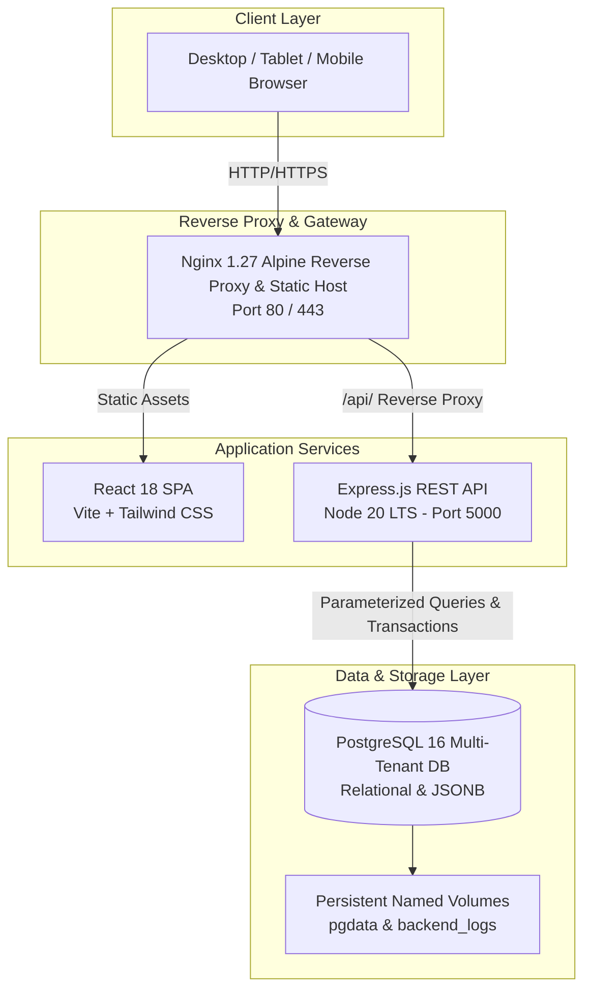

# Chandra Precision ERP — Enterprise Monorepo

> **Production-Grade Manufacturing, Financial Accounting (Tally Prime 9 Compatible), & Operations ERP**  
> Built with **Node.js 20 LTS + Express + PostgreSQL 16** (Backend) and **Vite + React 18 + Tailwind CSS** (Frontend).

---

## 1. System Architecture



---

## 2. Prerequisites & Environment

| Dependency | Minimum Version | Recommended Version | Verification Command |
| :--- | :--- | :--- | :--- |
| **Node.js** | `>= 20.0.0` | `20.18.x LTS` | `node --version` |
| **npm** | `>= 10.0.0` | `10.8.x` | `npm --version` |
| **PostgreSQL** | `>= 16.0` | `16.4 Alpine` | `psql --version` |
| **Docker Engine** | `>= 24.0.0` | `27.x` | `docker --version` |
| **Docker Compose** | `>= 2.20.0` | `2.29.x` | `docker compose version` |

---

## 3. Environment Configuration

Copy the example environment files into active `.env` files:

```bash
# Root / Docker Compose environment
cp backend/.env.example .env

# Backend local development environment
cp backend/.env.example backend/.env

# Frontend local development environment
cp frontend/.env.example frontend/.env
```

### Environment Variables Reference

| Variable | Required | Default / Example | Description |
| :--- | :--- | :--- | :--- |
| `NODE_ENV` | Yes | `production` \| `development` | Runtime environment mode |
| `PORT` | No | `5000` | Backend server port |
| `DB_HOST` | Yes | `localhost` (or `postgres` in Docker) | PostgreSQL host address |
| `DB_PORT` | Yes | `5432` | PostgreSQL port |
| `DB_USER` | Yes | `postgres` | Database username |
| `DB_PASSWORD` | Yes | `postgres_secure_password_2026` | Database password |
| `DB_NAME` | Yes | `sme_erp` | Database name |
| `DB_SSL` | No | `false` (set `true` for AWS RDS/Supabase) | SSL connection enforcement |
| `JWT_ACCESS_SECRET` | Yes | *256-bit cryptographic secret* | Secret key for signing Access Tokens (15m) |
| `JWT_REFRESH_SECRET` | Yes | *256-bit cryptographic secret* | Secret key for signing Refresh Tokens (7d) |
| `JWT_ACCESS_TTL` | No | `15m` | Access token lifespan |
| `JWT_REFRESH_TTL` | No | `7d` | Refresh token lifespan |
| `CORS_ALLOWED_ORIGINS`| Yes | `http://localhost:80,http://localhost:5173` | Comma-separated whitelist of client origins |
| `RATE_LIMIT_WINDOW_MS`| No | `900000` (15 minutes) | Rate limiting observation window |
| `RATE_LIMIT_MAX` | No | `1000` | Max requests per IP per window |
| `LOG_LEVEL` | No | `info` \| `debug` \| `warn` \| `error` | Pino log level |
| `SUPER_ADMIN_EMAIL` | Yes | `admin@chandraprecision.com` | Seed bootstrap Super Admin user email |
| `SUPER_ADMIN_PASSWORD`| Yes | `Admin@2026#Secure` | Seed bootstrap Super Admin password |

---

## 4. Getting Started Workflows

### Option A: Complete Docker Compose Deployment (Recommended)

1. Start all services in the background:
   ```bash
   docker compose up --build -d
   ```

2. Check container health status:
   ```bash
   docker compose ps
   ```

3. View live structured logs:
   ```bash
   docker compose logs -f backend
   ```

4. Access the web interface at [http://localhost](http://localhost) (or port 80).

---

### Option B: Local Development Workflow

1. **Setup Database & Seed Verified Users**:
   ```bash
   npm run db:migrate
   npm run db:seed:users
   npm run db:verify
   ```

2. **Start Backend API Server** (Port 5000):
   ```bash
   cd backend
   npm run dev
   ```

3. **Start Frontend Client** (Port 5173):
   ```bash
   cd frontend
   npm run dev
   ```
   Open `http://localhost:5173` in your browser.

---

### Default Seeded User Credentials for Testing & Login

| Email | Password | Role | Description |
| :--- | :--- | :--- | :--- |
| **`admin@chandraprecision.com`** | `Admin@2026#Secure` | `super_admin` | Global Super Administrator (Full Master & System Access) |
| **`admin@gmail.com`** | `admin123` | `super_admin` | Quick Demo Super Administrator |
| **`admin@yourdomain.com`** | `Admin@2026#Secure` | `super_admin` | Enterprise Administrator |
| **`manager@chandraprecision.com`** | `admin123` | `manager` | Plant & Operations Manager |
| **`operator@chandraprecision.com`** | `admin123` | `operator` | Shop Floor & Machine Operator |

---

## 5. Maintenance & Database Scripts

Run maintenance scripts from the root or `backend/` directory:

| Script Command | Purpose |
| :--- | :--- |
| `npm run db:migrate` | Runs PostgreSQL table migration, IF NOT EXISTS column alterations & seeds |
| `npm run db:seed:users` | Seeds known credentials for Admin, Manager, and Operator accounts |
| `npm run db:verify` | Verifies database entity structures and table coverage |
| `node scripts/sync-schema.mjs --check` | Validates schema synchronization between backend and frontend |

---

## 6. Testing Suite

```bash
# Run backend tests
cd backend && npm test

# Run frontend build & token assertion checks
cd frontend && npm run build
node check_tokens.mjs
```

---

## 7. Production Deployment Checklist

- [ ] **Secrets Rotation:** Generate unique 256-bit random strings for `JWT_ACCESS_SECRET` and `JWT_REFRESH_SECRET`. Never use default secrets in production.
- [ ] **Database Credentials:** Update `DB_PASSWORD` with a strong password; enable `DB_SSL=true` if using managed cloud databases (AWS RDS, GCP Cloud SQL, Azure).
- [ ] **CORS Origins:** Lock down `CORS_ALLOWED_ORIGINS` strictly to your production domain(s) (e.g. `https://erp.chandraprecision.com`).
- [ ] **Rate Limiting:** Adjust `RATE_LIMIT_MAX` based on your expected enterprise concurrent user count.
- [ ] **SSL / TLS:** Terminate TLS via Nginx / Cloudflare / ALB with valid HTTPS certificates.
- [ ] **Database Backups:** Schedule automated daily backups for the `sme_erp_pgdata` volume.

---

## 8. Troubleshooting & Common Issues

### 1. PostgreSQL Connection Refused (`ECONNREFUSED 5432`)
- **Cause:** PostgreSQL service not running or port conflict with an existing local Postgres instance.
- **Fix:** In `docker-compose.yml`, verify healthcheck status with `docker compose ps`. If running locally, check `pg_isready` and confirm `DB_HOST` is `localhost` (for local dev) or `postgres` (inside Docker).

### 2. CORS Error (`Access-Control-Allow-Origin Missing`)
- **Cause:** Request origin is not listed in `CORS_ALLOWED_ORIGINS`.
- **Fix:** Update `CORS_ALLOWED_ORIGINS` in `.env` to include the exact client domain, port, and protocol (e.g., `http://localhost:5173,http://localhost:80`).

### 3. JWT Authentication 401 (`TOKEN_EXPIRED` / `TOKEN_INVALID`)
- **Cause:** Expired access token or mismatched JWT secret.
- **Fix:** The frontend automatically performs single-flight silent refresh against `/api/auth/refresh`. Ensure `JWT_REFRESH_SECRET` matches across backend restarts.

### 4. Tally Prime XML Export Issues
- **Cause:** Missing company headers or authentication context.
- **Fix:** Verify active company selection in the top navigation bar. Exports are automatically scoped to the active tenant's `company_code`.

---

## 9. License

Proprietary enterprise software. All rights reserved by **Chandra Precision Engineering Pvt Ltd**.
